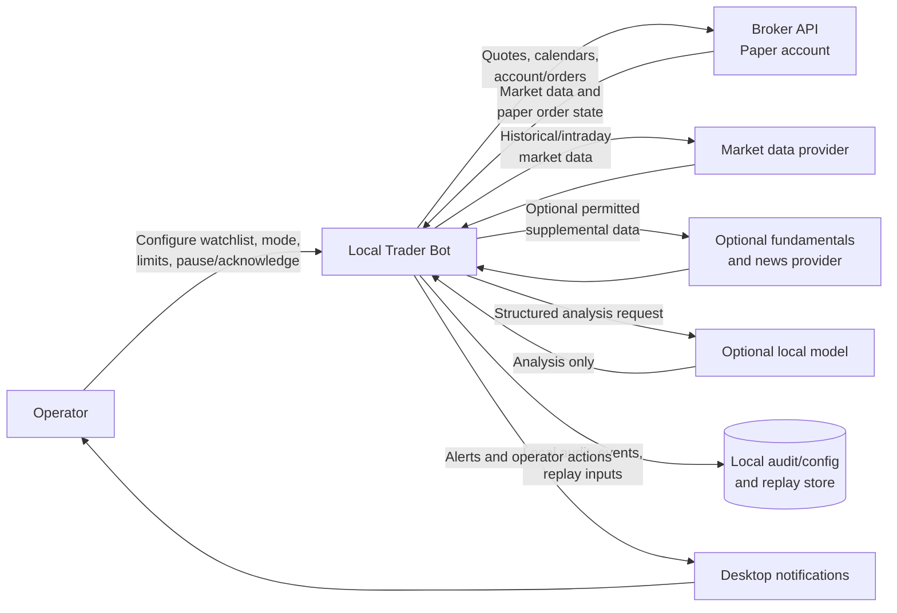
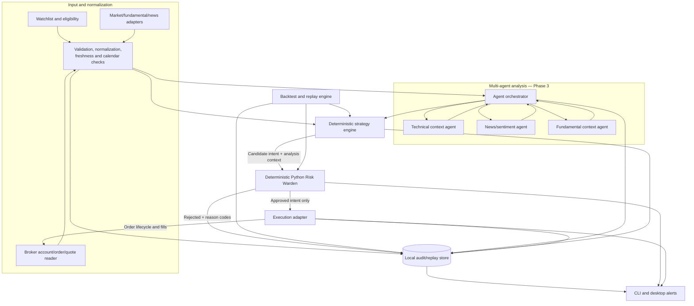
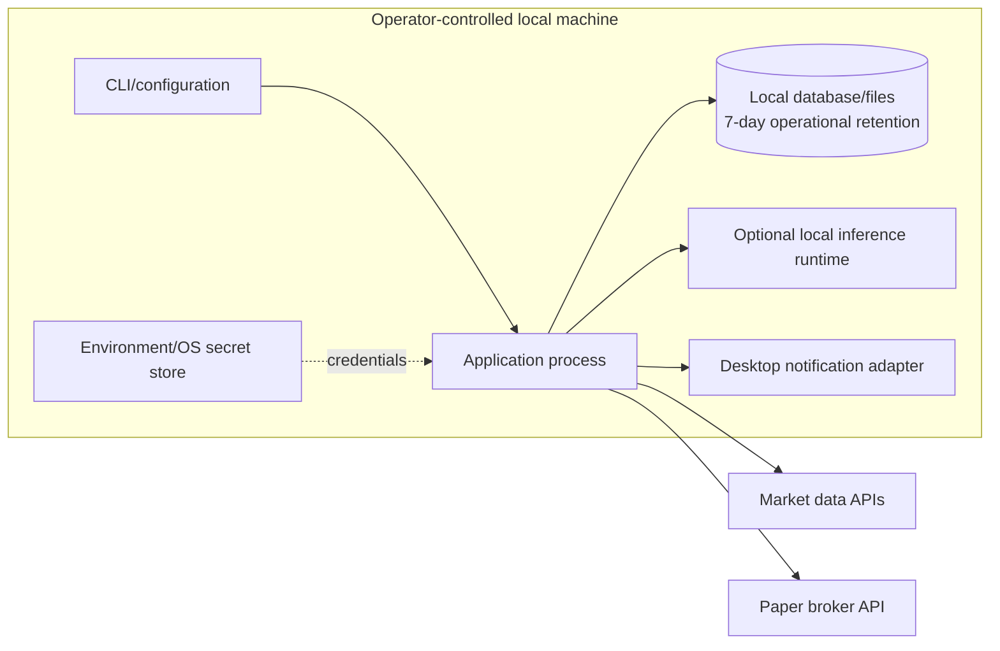

# System Architecture

**Status:** Design baseline; provider-specific behavior must be verified before paper orders.
**Related:** [Use cases](./use-cases.md), [Workflows](./workflows.md), [Contracts](./data-and-agent-contracts.md), [Security and operations](./security-and-operations.md).

## 1. Architectural goals

- Demonstrate a coherent AI multi-agent architecture without granting agents execution authority.
- Keep signals, risk calculations, and broker execution deterministic and testable.
- Support repeatable research/backtests and a safe paper-trading workflow.
- Fail closed when required information or safety state is unavailable.
- Make providers replaceable and record enough local evidence to explain and replay decisions.
- Keep the first release local and within a $0/month recurring-cost ceiling unless the operator explicitly approves a change.

## 2. System context

The broker adapter is authoritative for account, order, and position state. Market-data and enrichment providers supply timestamped observations; they do not authorize trades. External AI inference APIs are not used while the $0 cost cap is active.

## 3. Logical component architecture

### Component responsibilities and restrictions

| Component | Responsibility | Must not |
|---|---|---|
| Data adapters | Fetch provider data and preserve source/time metadata | Treat stale, unsupported, or incomplete data as current |
| Normalizer/validator | Normalize units, symbols, calendars, timestamps; check freshness | Guess missing values or silently substitute feeds |
| Technical context agent | Explain computed indicators and data context | Compute or alter order quantity; submit orders |
| News/sentiment agent | Summarize permitted, timestamped sources; return uncertainty/veto | Treat retrieved content as trusted instructions |
| Fundamental context agent | Summarize supported financial context and data quality | Silently become an intraday entry rule |
| Agent orchestrator | Invoke analysts, validate outputs, aggregate context/vetoes | Create deterministic signals; change risk configuration |
| Strategy engine | Generate versioned candidate signals from data and numeric rules | Authorize broker execution |
| Risk Warden | Deterministic sizing, eligibility, exposure and session checks | Delegate a numeric decision to an LLM |
| Execution adapter | Submit risk-approved intents; reconcile broker state | Accept intents from an agent or unapproved caller |
| Audit/notification services | Persist local evidence and notify operator | Log secrets or fail silently |

Analyst agents are separately testable components, not autonomous broker-connected workers. The orchestrator is the only agent coordinator. The strategy engine, risk gate, and execution adapter are ordinary deterministic services and are outside the LLM-agent trust boundary.

## 4. Deployment view

The first release is a single local application process with clearly separated modules and a local persistence boundary. The architecture does not require a distributed agent platform, cloud deployment, message broker, or hosted orchestration service.

Backtests must be runnable without broker credentials. Paper configuration must use paper-only credentials and endpoints. A live execution adapter is not part of the first-release deployment. It must not be reachable by changing a normal runtime mode flag.

## 5. Multi-agent phase placement

| Phase | Agent-related work |
|---|---|
| Phase 0 — Foundation | Define versioned request/result contracts, error states, timeouts, provenance fields, orchestration boundary, and tests. No model calls. |
| Phase 1 — Data/strategy | Implement deterministic indicators and candidate signals independently of AI. |
| Phase 2 — Risk/backtest | Implement deterministic risk gate and replay; no agent can approve a trade. |
| Phase 3 — Multi-agent analysis | Implement technical context, news/sentiment, and fundamental context agents; then implement orchestrator, local model adapter, validation, aggregation, and agent evaluation. |
| Phase 4 — Paper integration | Wire orchestrator report → deterministic strategy → risk gate → paper adapter. Agents receive no broker credentials and cannot call order methods. |
| Phase 5 — Validation | Exercise timeout, malformed output, conflicting context, unavailable local model, untrusted news, replayability, and cost limits. |

The strategy can operate deterministically if the optional model is disabled. If an enabled strategy configuration requires agent output and that output is absent, invalid, stale, or timed out, the proposal is rejected or held; no successful-looking fallback is permitted.

## 6. Strategy and decision boundary

The initial software-validation benchmark uses completed five-minute bars:

- Long candidate: EMA(9) crosses above EMA(21) and close is above EMA(50).
- Paper-only short candidate: inverse crossover and close below EMA(50).
- Initial protective-stop distance: 2.0 × ATR(14) at the completed signal bar.
- Backtest entry cannot occur before the next bar's open; slippage and fees are explicit parameters.
- Paper entry is a bounded limit derived from current bid/ask and expires after one five-minute bar.
- Technical/news AI context may veto or mark insufficient data, but may not create a signal. Fundamental analysis is context-only in the initial release.

This benchmark is an engineering fixture to validate data, agents, risk, and execution contracts. Its presence does not assert that it is suitable or profitable.
