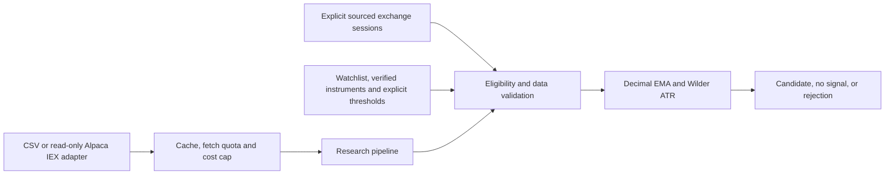

# Phase 1: Market Data and Deterministic Research

## Scope and component boundaries

Phase 1 implements data-to-candidate behavior only:



- [Market data](../src/trader_bot/market_data.py) defines the provider protocol,
  requests/snapshots, CSV normalization, usage policy and bounded cache.
- [Read-only Alpaca adapter](../src/trader_bot/providers.py) fetches historical
  five-minute unadjusted IEX bars and the latest IEX quote. It does not access broker
  accounts or trading endpoints.
- [Indicators](../src/trader_bot/indicators.py) compute deterministic EMA/ATR values.
- [Strategy](../src/trader_bot/strategy.py) validates data/eligibility and evaluates
  the experimental benchmark.
- [Pipeline](../src/trader_bot/pipeline.py) composes these boundaries and exposes
  provider failures as explicit rejected evaluations.
- [CLI](../src/trader_bot/cli.py) provides `analyze-csv` for offline inspection.

The technical AI agent will explain these computed indicators in Phase 3. Phase 1
does not use AI, approve risk, size orders, simulate fills, or submit orders.

## Data contracts and normalization

The CSV adapter accepts exactly these columns:

```csv
instrument_id,starts_at,open,high,low,close,volume
```

Each row is one unadjusted five-minute bar; `starts_at` must include an offset.
Times normalize to UTC and numeric strings to `Decimal`. The quote is a separate,
explicit timestamped observation, not a quote fabricated from a bar close.
Source/receipt metadata is attached to the snapshot. Currency, venue, symbol, and
calendar identity come from the separately supplied `Instrument`.

CSV files must contain a single matching instrument. Invalid schema, malformed
rows, invalid OHLC, non-finite values, and missing files are explicit errors.
Adapters select completed bars within the requested window; they never expose
the forming inclusive-end bar as a completed bar.

## Explicit policies, not guessed trading settings

Callers must supply:

- A configured watchlist and verified-instrument allowlist.
- USD stock/ETF identity on a supported US venue/calendar. Unverified or
  international instruments are skipped with a reason.
- Positive minimum price, minimum last-bar volume, maximum bid/ask spread in basis
  points, and maximum quote/bar age.
- Sourced, ordered, non-overlapping exchange sessions, including actual early closes.

`ExchangeSession` is an injected calendar boundary, **not** an automatically
maintained exchange calendar. The CLI accepts operator-supplied sessions for
offline research. Do not infer holidays or authorize paper trading from these
examples. Automated calendar verification remains required before paper execution.

Validation rejects missing, future, stale, duplicate, out-of-order, misaligned,
mixed-source, mixed-adjustment, or gapped bars. A gap across sessions is allowed
only when the previous session ends and the next supplied session begins.
Provider quality warnings, inconsistent quote timestamps, excessive spread,
insufficient volume, and unsupported markets also prevent candidates.

Entries stop at the start of the final 30 minutes, including early-close sessions.
The last bar must satisfy the configured age limit and its five-minute signal
expiry. Cached data is revalidated; a cache hit does not imply freshness.

## Indicator and benchmark definitions

- All calculations use a local Decimal context with precision 28.
- EMA seeds from the SMA of its first `period` closes, then uses alpha
  `2 / (period + 1)`. Earlier values are explicitly unavailable.
- ATR uses true range `max(high-low, abs(high-previous_close),
  abs(low-previous_close))`. The first bar uses `high-low`. ATR seeds from the
  first 14 true ranges' mean and applies Wilder smoothing thereafter.
- Default periods: fast EMA 9, slow EMA 21, trend EMA 50, ATR 14.
- Long: previous fast EMA <= previous slow EMA, current fast > current slow,
  and current close > trend EMA.
- Short: inverse crossing/filter, only when paper mode and paper shorting are
  explicitly enabled. Actual borrow/risk checks belong to Phase 2/4.
- Initial stop reference: close minus 2 x ATR for long, close plus 2 x ATR for
  short. A zero/nonpositive distance or nonpositive stop rejects the candidate.
- Only the latest completed bar can produce a signal. An expired or forming bar
  cannot generate a candidate. This phase has no fill simulator.

Strategy version/evidence records parameters, source, adjustment basis, computed
values, and quote timestamp. Outputs are `signal`, `no_signal`, or `rejected` with
reason and explanation. No output is a risk approval. The benchmark is for
software validation, not investment advice or a profitability claim.

## Cache, quota, and cost behavior

`UsagePolicy` requires a positive daily **fetch** quota; its defaults are zero paid
cost, 30-second cache TTL, and at most 128 entries. Cache keys include the
instrument and requested time window. Failed fetches consume quota and are not
cached. A positive declared fetch cost is rejected under a zero monthly cap
before the provider is called. The pipeline refuses a provider budget larger
than the approved runtime budget.

Usage accounting is in-memory for Phase 1 research, grouped by UTC day/month.
It is not a persistent billing ledger, and restart does not preserve usage.
Do not use it to authorize paid services. These adapters do not discover or
change account subscriptions.

The Alpaca adapter additionally counts **every HTTP request**, including failed
ones and pagination, and enforces a configurable rolling requests/minute limit
(default 30, an application throttle rather than a claim about the provider's
quota). It bounds pagination to five pages by default, does not retry failures,
never returns a silently truncated result, and does not follow redirects carrying
credentials. Responses have time/size bounds and errors omit secret-bearing
URLs/bodies. A stricter actual plan quota must be configured when verified.

## Read-only Alpaca integration

The adapter uses the official [historical stock bars API](https://docs.alpaca.markets/us/reference/stockbars)
and `GET /v2/stocks/{symbol}/quotes/latest?feed=iex` on
`https://data.alpaca.markets`. Historical bars explicitly select `5Min`, `raw`,
`iex`, ascending order, and bounded pagination.

Construction requires paper credentials and `free_feed_verified=True`; this is
an explicit caller acknowledgment, not automated entitlement verification. The
adapter must not be enabled until the operator verifies account eligibility,
feed rights, freshness, quotas, and cost. No real credentials were used in tests.
IEX is limited market coverage, not consolidated US market data. Missing IEX bars
fail validation rather than being interpolated.

`fetch(request, as_of)` restricts bars to the requested completed-data window.
The latest quote is a current observation, not a historical quote. For historical
replay, use archived quotes instead; do not pair a historical bar with today's
quote. When composing a network provider with `ResearchPipeline`, pass a UTC
evaluation `clock` so validation occurs after receipt, for example a callable
returning `datetime.now(UTC)`. Offline callers use an explicit historical `as_of`.
Receipt times are not backdated to make a snapshot appear valid.

## Tests and reproducible example

Run the standard-library suite:

```bash
python -m unittest discover -s tests -v
```

Tests cover exact EMA/Wilder ATR values and warm-up, crossover/no-signal/short
behavior, stop references, no-look-ahead, freshness boundaries, expiry, calendar
gaps/cutoffs, identity and source consistency, liquidity, CSV errors, cache
expiry/eviction, quota/cost limits, pagination, API errors, redirect protection,
and offline CLI output/exit codes. Network calls are mocked.

The [synthetic CSV fixture](../tests/fixtures/benchmark_long.csv) contains a fixed
long crossover. It is not real historical data and `DEMO` is not a verified
tradable symbol. The [README example](../README.md#offline-phase-1-example) uses
it without credentials or network access.

## Remaining gates

Phase 2 implements risk sizing, exposure/drawdown checks, and backtest/replay
fills. Phase 3 implements analyst agents. Phase 4 verifies live provider/account
capabilities, automated calendar coverage, persistence/recovery, and paper order
handling. None of the Phase 1 sample thresholds or synthetic observations
authorizes a real or paper trade.
