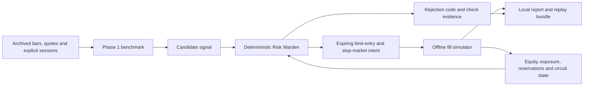

# Phase 2: Deterministic Risk, Backtesting and Replay

## Scope and boundaries

Phase 2 adds [Risk Warden](../src/trader_bot/risk.py),
[backtesting](../src/trader_bot/backtest.py), and [local replay bundles](../src/trader_bot/replay.py).
These are deterministic Python services, **not AI agents**. Phase 3 will add the
technical/news/fundamental analysts around the existing data and strategy
boundaries; no analyst will gain order authority.



No trading endpoint, broker account connection, inference, or live execution is
introduced. An offline `OrderIntent` is an immutable plan, not permission to call
a broker. Phase 4 must independently reconcile broker state, validate capabilities,
reserve outstanding orders, and enforce execution/idempotency controls.

## Risk accounting and sizing

Inputs must include a validated candidate, matching instrument/current quote,
fresh account snapshot, all marked open/reserved exposures, explicit session and
start-of-session equity, eligibility policy, and runtime mode. The caller must
explicitly confirm reconciled state and protective-order support; missing or
unknown support must not be assumed true by an execution integration.

Only USD instruments are supported; unverified FX conversion fails closed.
Positions and outstanding entry reservations count toward gross notional, total
short exposure, and planned open loss. The same symbol cannot be pyramided,
hedged, or submitted again while exposure/reservations exist. The gate is
deterministic/stateless apart from its explicitly supplied circuit state:
callers must include every approved pending entry in subsequent exposures.

Provisional accepted defaults:

| Limit | Default |
|---|---|
| Planned per-trade risk | 0.25% of current equity |
| Per-position notional | 5% of current equity |
| Combined planned open risk | 1% of current equity |
| Daily equity-loss breaker | 1% of session-start equity |
| Gross exposure without borrowing | 1x equity |
| Explicitly enabled paper gross exposure | 1.25x equity |
| Total short exposure, paper-only | 10% of equity |
| One short position, paper-only | 2.5% of equity |
| Quantity step / price tick | 1 share / USD 0.01, configurable |

All arithmetic runs in a local Decimal context with precision 28.
Entry limits are bounded against current ask (long) / bid (short), default
maximum deviation 10 basis points. Buy limits round down to the price tick;
sell limits round up. Long stops round down, short stops round up, conservatively
increasing planned stop distance. Invalid/zero prices or stops on the wrong side
of the entry are rejected.

For a long:

`unit_risk = entry_limit - rounded_stop + round_trip_cost_per_share`

For a short:

`unit_risk = rounded_stop - entry_limit + round_trip_cost_per_share + borrow_cost_per_share`

Available quantity is the minimum allowed by:

- per-trade risk divided by unit risk;
- position notional divided by entry limit;
- remaining aggregate open-risk allowance divided by unit risk;
- remaining gross-exposure allowance divided by entry limit;
- buying power divided by entry limit plus the conservative cost allowance;
- short-position and remaining aggregate-short allowances when applicable.

Round quantity **down** to the configured increment. If even one increment
does not fit, reject with the binding constraint code instead of rounding up.
Every approval records quantity, notional, planned risk, policy fingerprint,
check evidence, and a stable idempotency key tied to the signal identity.
Changing sizing parameters changes the risk-policy fingerprint.

The gate independently checks mode, identity, quote spread/price/freshness,
account freshness (default 30 seconds), candidate completion/expiry, supported
calendar/session, and the final-30-minute entry cutoff. It does not redo technical
analysis or claim that an arbitrary candidate is profitable.

Shorts require **paper mode**, opt-in, explicit borrow availability and explicit
borrow-cost assumptions. Backtest mode rejects short candidates in the existing
Phase 1 benchmark; no live shorting/leverage is enabled. Short order-intent and
adverse fill behavior are covered by offline unit tests, not real broker certification.

## Daily circuit breaker

`current_equity <= session_start_equity * (1 - daily_drawdown_limit)` trips the
breaker, including equality. Equity includes realized/unrealized P&L and modeled
fees. Once tripped, it remains latched for the supplied session even if equity
recovers; there is no automatic intraday reset. A new explicitly identified
session requires a new baseline. No deposits/withdrawals or FX cash flows are
modeled.

`CircuitState` is an immutable, restorable snapshot; reports include session
states. A future paper controller must persist this state transactionally and
require operator review. There is no paper-service lifecycle/persistence yet.
The offline runner cancels pending entries on a breach while preserving existing
protective stops. It does not liquidate an existing position merely because the
breaker tripped.

## Fill simulation and causal timing

The runner is intentionally **single-instrument, USD, unleveraged and long-only**.
This bounds the first backtest implementation; the reusable Risk Warden separately
supports the accepted paper shorting/leverage caps. Portfolio-wide strategies,
short borrow simulation and live/paper execution remain outside this runner.

The benchmark sees only completed bars and archived quotes received by the
evaluation time. Quote absence, staleness, or future receipt cannot be replaced by
inventing bid/ask from a bar close. No network is used for historical replay.

1. Evaluate the strategy at a completed five-minute bar's end.
2. Risk-check with the quote and simulated account state then available.
3. Hold the approved intent until the **next bar's open**, never the signal bar.
4. Recheck risk using that open's account mark and the latest already-received
   quote. Quantity may decrease, never exceed the original approval.
5. Simulate a limit entry at the open plus adverse per-share slippage. If that
   price violates the limit or the protective stop side, do not fill.
6. Bound quantity by a configurable fraction of the **previous completed bar's
   volume**. It is a causal liquidity proxy, not a representation of queue position
   or actual opening liquidity. Future bar volume never changes that open's fill.
7. Cancel the unfilled remainder after this one five-minute bar. The filled
   quantity is immediately covered by the protective-stop plan.
8. If the entry bar crosses the protective stop, conservatively simulate an exit
   in that bar. Intrabar path is unknown.

Only open-marketability is modeled for limit entries; intrabar limit touches do
not create fills. Long stop exits use `min(open, stop) - slippage`; short stop
tests use `max(open, stop) + slippage`. Gaps can produce realized loss beyond
planned stop risk. Stops assume full exit liquidity, which is a known simulation
limitation. A gap stop is timestamped at the open; a non-gap intrabar stop is
recorded at bar end because exact event time is unavailable.

An existing position is flattened at the available bar open five minutes before
the explicit session close. This is a **simulated session exit**, not a broker
market order. Missing closing data does not imply successful liquidation.
An unresolved position at dataset end is marked at the last close and explicitly
reported as incomplete. Pending entries without a next bar also make a run
incomplete. Missing/stale market data is not a successful-looking zero-trade run.

Fees and slippage are explicit per-share assumptions (defaults zero). The risk
round-trip cost allowance must cover at least twice their sum. Reports calculate
realized P&L net of both entry and exit fees, total fees, close-marked equity,
and close-to-close maximum drawdown including initial equity. Intrabar worst-case
drawdown, dividends, corporate-action cash flows, latency and queue position are
not simulated.

## Reproducibility, serialization and local storage

`BacktestInput` includes all bars, archived quotes, instruments, supplied sessions,
eligibility filters, strategy/risk/fill settings, initial equity, and dataset label.
Reports include:

- SHA-256 fingerprints of canonical inputs and actual Python package source;
- strategy/risk policy versions and approved order intents;
- timestamped risk/rejection/fill/cancel events and equity curve;
- circuit snapshots, fees/P&L/drawdown, unresolved quantity, completeness and limitations.

A replay bundle contains `schema_version`, `input`, and `report`. An input-only
bundle has `report: null`. Decimals serialize as strings and timestamps as UTC;
credentials/runtime configuration cannot be serialized through this reporting
interface. The strict reader rejects unknown fields, duplicate JSON keys, invalid
domain records, unsupported versions, and oversized files.

`replay` reruns the recorded inputs and compares the entire result, including
source fingerprint. Changed code, tampered results or modified inputs produce a
`REPLAY_MISMATCH` error, not a claim of exact reproduction. Changing documentation
alone does not change the source fingerprint.

Files are local-only and existing files are never overwritten. Use the ignored
`local-data/` directory. Bundles are explicit research artifacts; their long-term
retention remains an operator decision. Seven-day operational log pruning and
paper safety-state persistence are not implemented by the offline CLI.

## Commands and validation

See the [README example](../README.md#offline-phase-2-example) and
[synthetic generator](../examples/phase2_demo.py). `DEMO` and its observations are
synthetic software fixtures, not actual historical data or a tradable recommendation.

```bash
python -m unittest tests.test_risk tests.test_backtest tests.test_replay -v
python -m unittest discover -s tests -v
```

`backtest --input INPUT --output NEW_REPORT` runs an input bundle and records
evidence. `replay --input REPORT` verifies it. Both require backtest mode and
return exit status 2 for invalid inputs, mismatch, unresolved positions or an
incomplete run. Evidence for a valid but incomplete run is still saved.

Tests cover exact sizing/rounding/caps, pending exposure, inclusive drawdown
latching/restoration, short permissions/borrow, currency/freshness/session checks,
bounded intents, no-look-ahead, partial fills, gaps and same-bar stops, session
flattening, net fees/P&L, missing quotes/data, deterministic replay, tampering,
safe file creation, CLI errors, and absence of network calls.
