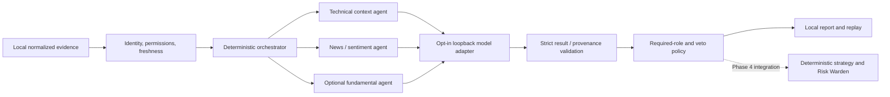

# Phase 3: bounded multi-agent analysis

Phase 3 implements independent technical-context, news/sentiment and
fundamental-context analysts, an opt-in local model adapter, deterministic
orchestration, and local analysis recording/replay. No analyst is an execution
authority. This is research software, not investment advice or evidence of
profitability.

## Architecture and boundaries



- [Analysts and orchestrator](../src/trader_bot/agents.py) use the existing Phase 0
  `AgentRequest`, `AgentResult` and `AgentAnalysisReport` envelopes. Each role is a
  separate, independently testable component sharing a replaceable async model
  protocol. The orchestrator itself is not an LLM.
- [The local adapter](../src/trader_bot/local_model.py) uses Ollama's installed-model
  listing and non-streaming chat APIs. It has no tool-calling or Python execution
  capability, no credential fields, and no external endpoint setting.
- [Analysis bundles](../src/trader_bot/analysis_io.py) retain normalized evidence,
  explicit policy, validated outcomes, prompt version, model identity/version,
  correlation/instrument IDs, and input/implementation/decision fingerprints.
- Agents receive no runtime configuration, account state, risk configuration or
  broker client. Ordinary Python object separation is not a hostile-plugin sandbox:
  injected Python adapters must be trusted. Model text is never executed.
- Phase 1 research and Phase 2 simulation/replay remain deterministic and do not
  invoke agents. Connecting an analysis hold to the paper strategy/risk workflow
  is Phase 4 work. `can_continue=True` only clears this analysis policy; it cannot
  generate a signal, change its stop, choose a quantity, or authorize an order.

## Evidence contract

Inputs are local snapshots, not automatic news/fundamental retrieval. Operators
must verify source permission/licensing and provenance. `permission_verified`
is an explicit operator acknowledgment, not independent entitlement proof.

Each immutable `Evidence` includes a role, instrument ID, source/reference ID,
observed/publication time, received time and permission acknowledgment.

| Role | Required content | Default maximum observation age |
|---|---|---|
| Technical | Already-computed `close`, `volume`, `ema9`, `ema21`, `ema50`, `atr14`, each with a finite Decimal value and explicit unit | 60 seconds |
| News/sentiment | Timestamped attributed text, at most 8,000 characters | 24 hours |
| Fundamental | Named financial metrics/units and a financial period end no later than publication | 120 days |

These freshness values are **offline research defaults**, not certified paper
trading requirements. All thresholds are stored in the explicit analysis policy.
Financial observation freshness uses publication time; the period is displayed
as context, not assumed to be a current intraday observation.

- At most 32 records per run, unique reference IDs, one matching instrument.
- At most 64 unique metrics per record. Decimal strings preserve numeric values.
- Unknown fields/roles, duplicate JSON keys, nonfinite numbers, invalid periods,
  naive timestamps and oversized inputs are rejected.
- Unpermitted evidence is invalid. Missing/stale/future evidence is insufficient.
  No data is fabricated and unavailable inference is not replaced with neutral
  analysis.
- Any invalid record for a role prevents that role's inference. Received and
  observed timestamps must be no later than the explicit snapshot as-of time.
- Technical metrics must come from validated completed bars and the deterministic
  indicator services; these analyst inputs do not independently certify how
  upstream metrics were calculated.

## Deterministic policy

Default policy:

| Condition | Outcome |
|---|---|
| Technical or news result invalid, insufficient, unavailable or timed out | Hold: `can_continue=False`, with a role-qualified reason code |
| Technical or news valid veto | Hold: `AGENT_VETO:<role>`; a positive result from another role cannot override it |
| Fundamental missing, failed or uncertain | Record status/context; no intraday influence |
| Fundamental attempts a veto | Invalid fundamental output; never an intraday veto |
| All required roles valid and no configured veto | Analysis may continue; strategy and numeric risk checks are still mandatory |

Fundamentals cannot be configured as required or veto-capable in this release.
Technical/news required and veto roles are explicit tuples; a research operator
may deliberately make either optional or disable its veto. This policy is
archived, never inferred from model text. Empty tuples are an explicit analysis
opt-out, **not** permission to bypass strategy, risk, or execution checks.

Independent roles run concurrently with a common deadline (10 seconds by
default, configurable from 1 to 30). Results are ordered by the canonical
`AgentRole` enum, not completion order. Missing/invalid/unavailable/timeout
outcomes are retained explicitly. Reason codes include `AGENT_INVALID`,
`AGENT_INSUFFICIENT_DATA`, `AGENT_UNAVAILABLE`, `AGENT_TIMEOUT`, and `AGENT_VETO`.
Unexpected programming errors and caller cancellation propagate, rather than
being relabeled as successful context.

The local adapter additionally applies socket and async inference timeouts.
Cancellation cannot forcibly kill a standard-library HTTP worker thread;
executor cleanup can outlast the orchestration deadline until socket operations
finish or time out. A trusted local daemon is required; this is not a hard
real-time inference service.

## Prompt and output defenses

Each role has a fixed, versioned system instruction. Evidence is JSON-encoded
in a separate user message under `untrusted_evidence`; it is never inserted as a
system instruction. Obvious instruction/role impersonation and order/risk-change
patterns in retrieved content are quarantined before inference.

The model must return exactly:

```json
{
  "summary": "Concise attributed context.",
  "facts": ["A fact attributed to the supplied evidence."],
  "interpretation": "Explicitly uncertain interpretation, not an execution instruction.",
  "uncertainty": "high",
  "veto": false,
  "warnings": [],
  "source_refs": ["supplied-reference-id"]
}
```

Only supplied references may be cited; at least one citation is required.
Extra fields (including orders, quantities or risk settings), string booleans,
unknown uncertainty values, duplicate list entries, fenced JSON, instruction-like
output and fundamental vetoes are invalid. Output text is bounded to 32 KB, the
HTTP response to 64 KB, and local bundles to 1 MB. Facts and interpretation are
kept separately labeled in the normalized result summary.

These defenses do **not** prove semantic truth, eliminate hallucinations, or
detect every prompt injection. A malicious model may still misdescribe evidence
or cause a conservative hold. Safety does not depend on textual detection:
there are no tools, no executable action fields, and no numeric/order authority.
Human review and future model evaluation remain necessary.

## Local inference and zero recurring cost

Inference is disabled by default. Enabling it requires all of:

1. A separately installed, trusted local Ollama daemon and already installed,
   appropriately licensed model. This project does not install, pull or download
   a model automatically.
2. Run the daemon with cloud functionality disabled (`OLLAMA_NO_CLOUD=1`) and
   deny daemon network egress if strict offline guarantees are required. A
   loopback address alone cannot attest that another process never proxies data.
3. Explicit `TRADER_BOT_LOCAL_MODEL_ENABLED=true`, exact installed model name
   (including tag), and pinned `sha256:<64 lowercase hex digits>` manifest digest.

The adapter connects only to `127.0.0.1`, default port 11434. No DNS endpoints,
environment HTTP proxies, redirects, authentication headers, retries, downloads,
paid API SDKs or tool calls are used. Cloud-named models and installed-model
records advertising remote hosts/models are refused. The installed digest must
match the pin before each generation; bare and `sha256:`-prefixed Ollama digests
are accepted. The daemon/model store is trusted and must not be modified during
analysis. Pin verification is not cryptographic attestation of daemon behavior.

Generation requests use JSON mode, temperature/seed zero and a 1,024-token output
bound. These settings improve repeatability but do not guarantee identical LLM
generation. Model/hardware quality and latency have **not** been certified.

## Runnable synthetic walkthrough

From the repository root after the existing editable install:

```bash
mkdir -p local-data
python examples/phase3_demo.py --output local-data/agents-input.json
trader-bot analyze-agents \
  --input local-data/agents-input.json \
  --output local-data/agents-disabled.json \
  --as-of 2026-01-02T19:00:00Z
```

With default configuration this records explicit unavailable required analysis
and exits **2**. It makes no model/network call. The data is synthetic and not
a verified tradable security. The as-of timestamp describes a logical evidence
snapshot, not a claim that inference ran historically; actual waiting uses the
async timeout.

To exercise the full policy/replay path without pretending to run AI:

```bash
python examples/phase3_demo.py \
  --output local-data/agents-fixture.json --fixture-report
trader-bot replay-analysis --input local-data/agents-fixture.json
```

The test double is explicitly labeled `provider=fixture`,
`synthetic-demo-not-ai`. It is never used as a fallback for unavailable inference.

With a verified local daemon/model, replace the placeholders with the exact
installed name/digest (this command is not needed for the offline walkthrough):

```bash
TRADER_BOT_LOCAL_MODEL_ENABLED=true trader-bot analyze-agents \
  --input local-data/agents-input.json \
  --output local-data/agents-local.json \
  --as-of 2026-01-02T19:00:00Z \
  --model YOUR_INSTALLED_MODEL:TAG \
  --model-version sha256:YOUR_64_CHARACTER_MANIFEST_DIGEST
```

Use new filenames: output files/symlinks are never overwritten. Exit **0**
means analysis policy can continue, **2** means a recorded hold or explicit
configuration/data/replay error. A replay can verify a recorded hold successfully
while still exiting 2; this is not a new approval.

## Replay, provenance and retention

`replay-analysis` revalidates archived envelopes, source references, evidence
quality, timestamps and policy, then recomputes the deterministic decision
without calling a model. It compares the complete decision, input fingerprint,
implementation fingerprint and prompt version. Recorded outcome changes are
also detected by a decision fingerprint.

This is **recorded-outcome policy replay**, not a claim that an LLM can regenerate
the same words or that the stored facts are true. Fingerprints detect accidental
changes; they are not signatures or protection against someone rewriting the
whole local archive. Invalid raw generations are not retained; their sanitized
failure status is recorded. Reviewed valid facts/interpretations and all supplied
evidence are local report data and may themselves be sensitive.

`local-data/` remains Git-ignored. Research report/dataset retention is still an
open product decision. Automatic seven-day operational audit storage/rotation
and durable paper workflow integration remain Phase 4 work; this CLI does not
silently delete research archives or promise an implemented retention daemon.

## Validation

```bash
python -m unittest tests.test_agents tests.test_local_model tests.test_analysis_io
python -m unittest discover -s tests
```

Tests cover independent roles, strict schemas, provenance, required/optional
failures, conflicting vetoes, exact freshness boundaries, deadlines and
cancellation, obvious prompt injection, paper/live separation, local-only HTTP
and digest checks, duplicate/oversized/tampered bundles, no-overwrite behavior,
CLI operation, and model-free replay. Transport is tested with mocks and an
ephemeral loopback HTTP stub, not an external service or real inference engine.
