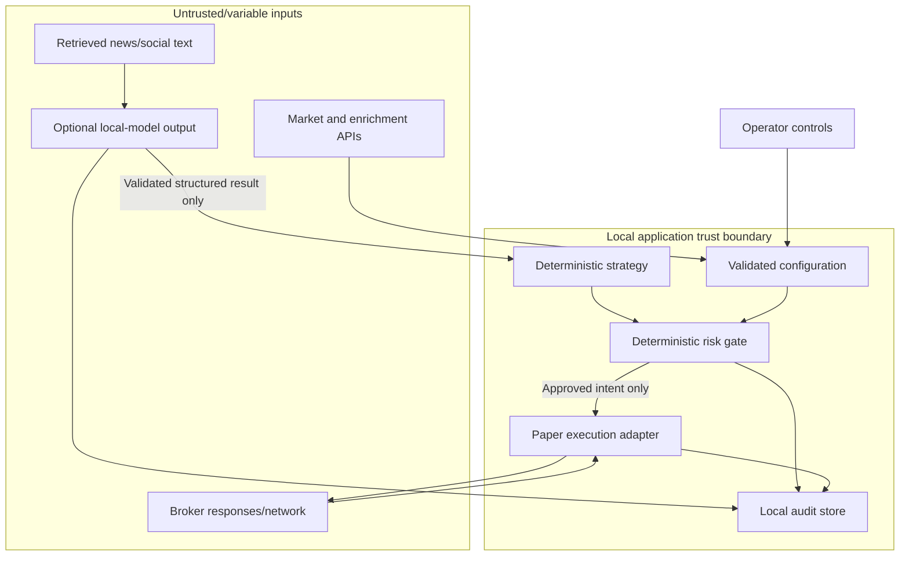

# Security, Safety, and Operations

## 1. Trust boundaries

The diagram's input arrows indicate data crossing a boundary, not trust. Provider, model, news, broker, and network content must be validated. The deterministic risk gate is a security boundary: no analyst or orchestrator has access to it as an authority and no agent can invoke order submission.

## 2. Safety controls

- Backtest and paper modes cannot load live credentials/endpoints. Live execution is not delivered in the first release.
- Paper mode is visibly identified at startup, in logs, alerts, and order summaries.
- `paper-pause` persistently disables new entries; it does not cancel existing orders or liquidate positions. Resumption requires explicit broker reconciliation.
- Shorting/leverage are paper-only in the first release: gross exposure ≤ 1.25× equity; total short exposure ≤ 10%; one short ≤ 2.5%; one position notional ≤ 5%; planned risk at stop ≤ 0.25% per trade; combined planned open risk ≤ 1%.
- Daily drawdown breaker at 1% blocks entries, cancels eligible unfilled entry orders, preserves protective exits, and requires operator acknowledgment. This provisional accounting/policy must be verified in tests before paper orders are enabled.
- A protective stop is not a guaranteed maximum loss. Market gaps, halts, rejection, and slippage can exceed planned risk.
- Unsupported or uncertain market, data, order, calendar, borrow, or account state means skip/reject and report reason.
- International instruments are skipped unless all market, broker, currency, data, calendar, and order support are verified.
- No paid service is called without explicit operator approval under the $0/month cap.

## 3. Secrets, local data, and privacy

- Load API credentials from environment variables or an operating-system secret store; never commit or log them.
- Keep paper credentials distinct from any future live credentials. Do not use a mode switch that can accidentally select live secrets.
- Local operational audit records have seven-day retention; expired records are deleted. Any backtest dataset retention is separately configured and documented.
- No external logging/telemetry service is used. Desktop notifications are local. Optional email must be free, explicitly configured, and must not affect safety behavior.
- Encrypt sensitive local state where practical and document local file permissions, backup behavior, and deletion. Backups can extend effective retention, so the operator must be told if they do.
- Retrieved news/social text is untrusted input. Use bounded excerpts, source/time provenance, and output schema validation; never concatenate retrieved text into privileged instructions.

## 4. Failure behavior

| Failure/uncertainty | Required behavior |
|---|---|
| Missing, stale, malformed, or unsupported data | No new entries; log and explain |
| Agent invalid, timed out, unavailable, or vetoed | Apply explicit policy; fail closed if required; no fallback approval |
| Free API quota exhausted or cost cap would be exceeded | Skip affected capability/instrument; no paid fallback |
| Broker disconnected or order response unknown | Persist entry halt; reconcile before resuming |
| Protective exit rejected/unconfirmed | Halt new entries; alert operator; reconcile and require acknowledgment if unresolved |
| Startup finds mismatched positions/orders | Do not trade; query broker, reconcile, and report |
| Calendar/clock/session uncertain | No new entries; preserve existing protection and alert |
| Circuit breaker trips | Cancel eligible unfilled entries, preserve protective exits, require acknowledgment |
| Local audit storage fails | No order submission; report explicit persistence failure |

Retries must be bounded, idempotent, and observable. Never report a successful order, fill, exit, or recovery without broker-confirmed state.

## 5. Operational lifecycle

1. **Start:** Validate config/mode/secrets, clock, calendar, provider connectivity, and local storage.
2. **Reconcile:** In paper mode, load broker account, positions, and open orders before enabling analysis.
3. **Run:** Process completed bars at five-minute cadence; refresh state; evaluate watchlist and safety checks.
4. **Pause/stop:** Persist entry-disable state, cancel eligible open entry orders, preserve protective exits, and explain open exposure.
5. **Recover:** Reconcile provider and broker state after reconnect/restart; unresolved conditions require acknowledgment.
6. **Retention:** Prune local operational records older than seven days; report pruning/storage errors.

## 6. Security and reliability verification

- Tests prove no live endpoint/credential can be reached in backtest or paper mode.
- Secret scanning and log-redaction tests cover exceptions and broker/provider errors.
- Property/boundary tests cover decimal sizing, rounding, currency, leverage, short caps, drawdown, and session cutoffs.
- Fault tests cover duplicate requests, timeouts, malformed provider/agent responses, partial fills, rejected protective exits, storage failure, restart, and reconnect reconciliation.
- Prompt-injection tests verify news/social content cannot alter system rules, numeric risk limits, or broker authority.
- Paper integration tests assert all submitted URLs/endpoints are paper-only.
- Retention tests prove seven-day deletion without deleting active circuit-breaker or order state needed for safe recovery.
