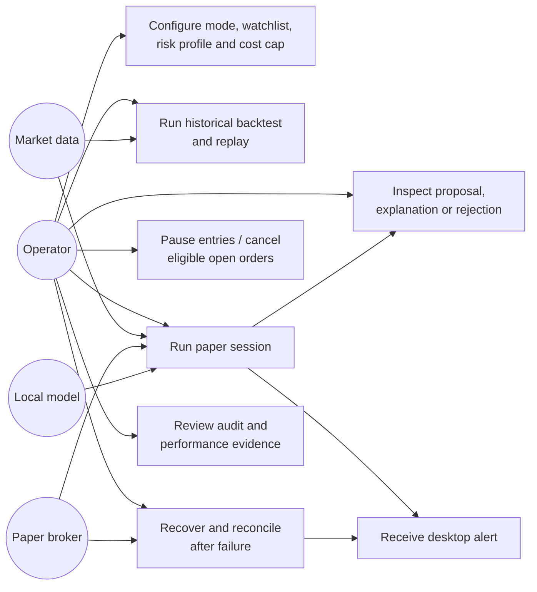

# Use Cases and Requirements

**Primary actor:** Operator (the system owner).
**External systems:** Market-data provider(s), optional enrichment provider, optional local model runtime, paper broker API, local desktop notification service.

## 1. Actors and goals

| Actor | Goal |
|---|---|
| Operator | Configure watchlist and limits, run backtests/paper trading, understand decisions, pause safely, and acknowledge unresolved safety state |
| Market-data provider | Supply timestamped historical/intraday market observations and market status |
| Paper broker | Provide paper account state, accept/cancel paper orders, and report acknowledgments/fills |
| Analyst agents | Produce structured, source-aware analysis context within narrow responsibilities |
| Agent orchestrator | Coordinate analysts and produce a validated analysis report |
| Risk Warden | Deterministically accept/reject candidate intents |
| Local audit store | Preserve decision/order evidence and replay inputs for configured retention |

AI agents are system components, not privileged actors. They cannot act as the operator, risk gate, or broker.

## 2. Use-case diagram

## 3. Use-case specifications

### UC-01: Configure and validate the system

- **Preconditions:** Application is installed locally; no live mode is available.
- **Main flow:** Operator selects backtest or paper mode, configures a watchlist and risk profile, configures provider credentials via a secret store/environment, sets the $0 cost cap, and validates configuration.
- **Alternative flows:** Unsupported market/symbol, missing credential, unknown calendar, paid-only data, or invalid threshold is rejected with a clear reason.
- **Postcondition:** A versioned configuration is saved locally; secrets are not stored in plaintext configuration or logs.
- **Acceptance:** Invalid configuration cannot start an active trading session.

### UC-02: Run historical backtest and replay

- **Preconditions:** Strategy version and historical data range are selected; dataset has known source and timestamps.
- **Main flow:** System validates data, computes indicators/signals, applies the same deterministic risk rules, simulates order lifecycle with explicit fees/slippage, and stores result metadata.
- **Alternative flows:** Missing/stale/incompatible data causes an explicit failed or partial run; no fabricated data is used.
- **Postcondition:** Results can be reproduced from strategy, code, configuration, and data identifiers.
- **Acceptance:** No look-ahead is allowed; a signal on a completed bar cannot fill before the next bar's open.

### UC-03: Analyze a watchlist item and propose a paper trade

- **Preconditions:** Paper mode, eligible instrument, valid broker account state, current quote/bars, and session calendar are available.
- **Main flow:** Normalize snapshot → compute deterministic candidate → invoke configured analyst agents → validate/aggregate agent outputs → apply vetoes → run risk gate → explain approved/rejected result.
- **Alternative flows:** Agent timeout/invalid result, no signal, stale quote, unsupported instrument, no available data under cost cap, or market filter failure results in a rejection/skip with reason.
- **Postcondition:** No broker order exists unless the risk gate approved a proposal.
- **Acceptance:** Every decision records strategy/config/version and data/agent provenance.

### UC-04: Submit and manage a paper order

- **Preconditions:** UC-03 produced a risk-approved intent; paper mode and paper endpoint are verified.
- **Main flow:** Recheck quote/session/account state → submit bounded limit entry with idempotency key → reconcile acknowledgment → expire after one five-minute bar if unfilled → track fills → attach/confirm protective stop-market exit where supported → reconcile positions/orders.
- **Alternative flows:** Rejection, partial fill, disconnect, missing protective order, or unknown response halts new entries and raises alert; reconciliation determines actual broker state.
- **Postcondition:** Local order lifecycle agrees with broker state or remains explicitly unresolved and requires operator action.
- **Acceptance:** Duplicate delivery cannot create duplicate orders; agents cannot submit or amend orders.

### UC-05: Trip a risk/session guard

- **Preconditions:** Paper session is active and risk/session rules are configured.
- **Main flow:** Risk gate detects a threshold violation or session cutoff; rejects new entries, cancels eligible unfilled entry orders, preserves protective exits, records reason, and alerts operator.
- **Alternative flows:** Broker cancellation fails or state is uncertain; entries remain disabled until reconciliation and required operator acknowledgment.
- **Postcondition:** Circuit-breaker/session state is durable across restart.

### UC-06: Pause and emergency stop

- **Preconditions:** System is running.
- **Main flow:** Operator issues pause/entry-disable; system blocks new entries, attempts eligible order cancellations, reports open positions and protective exits, and logs action.
- **Alternative flows:** Broker unavailable; local entry-disable persists and operator receives an unresolved-state alert.
- **Postcondition:** Restart does not clear the pause without an explicit resume/acknowledgment.

### UC-07: Recover after restart or outage

- **Preconditions:** Startup finds unresolved local state, stale data, an outage marker, or broker/local mismatch.
- **Main flow:** Keep entries disabled → query broker orders/positions/account → reconcile local state → restore circuit-breaker/session state → report discrepancies.
- **Alternative flows:** Broker/data/calendar remains unavailable or mismatched; remain halted and require manual acknowledgment.
- **Postcondition:** No new entry until broker state and protective coverage are understood.

### UC-08: Inspect explanation and audit record

- **Preconditions:** A proposal, order, rejection, or alert exists.
- **Main flow:** Operator views timestamp, instrument, source/data freshness, summarized agent outputs, deterministic signal, rule checks, amount/quantity/notional/risk, order/fill status, and rejection reason.
- **Postcondition:** Evidence remains local and is retained for seven days; expired operational records are deleted.

## 4. Requirements traceability

| Concern | Primary document |
|---|---|
| Components and trust boundaries | [Architecture](./architecture.md) |
| Normal and exceptional interactions | [Workflows](./workflows.md) |
| Message schemas and data ownership | [Data and agent contracts](./data-and-agent-contracts.md) |
| Failure/security/retention behavior | [Security and operations](./security-and-operations.md) |
| Decisions, open items, and phase gates | [Decisions and implementation plan](./decisions-and-plan.md) |
