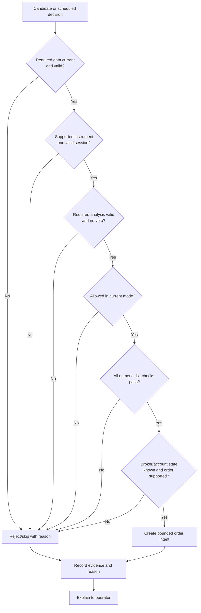
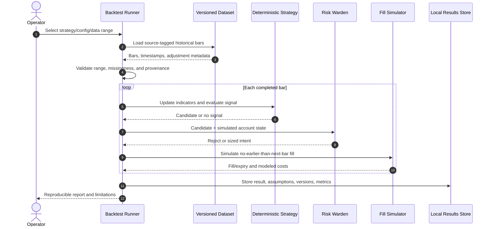
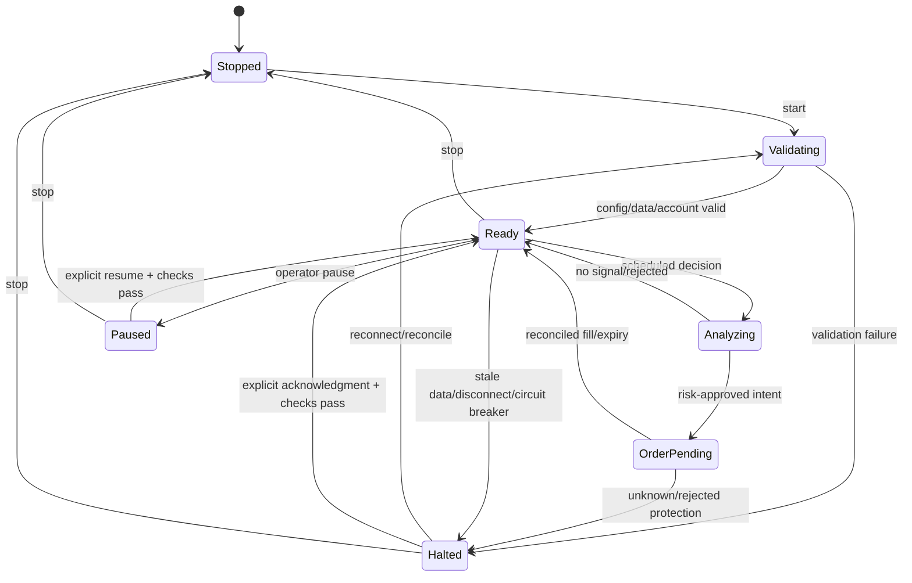

# Workflows and Sequence Diagrams

These diagrams describe intended behavior, not broker-specific API details. Adapter behavior must be verified against the selected paper account before integration.

## 1. Paper signal-to-order sequence

```mermaid
sequenceDiagram
    autonumber
    actor Operator
    participant App as Session Controller
    participant Feed as Data Adapter
    participant Cal as Calendar/Eligibility
    participant Strategy as Deterministic Strategy
    participant Orch as Agent Orchestrator
    participant TA as Technical Context Agent
    participant SA as Sentiment Agent
    participant FA as Fundamental Context Agent
    participant Risk as Risk Warden
    participant Broker as Paper Broker
    participant Audit as Local Audit Store

    Operator->>App: Start paper mode
    App->>Broker: Verify paper endpoint/account
    Broker-->>App: Account, positions, open orders
    App->>Feed: Fetch completed five-minute bars and quote
    Feed-->>App: Data + source/time/freshness metadata
    App->>Cal: Validate supported instrument/session
    Cal-->>App: Eligible or skip reason
    App->>Strategy: Compute deterministic candidate
    Strategy-->>App: Candidate or no-signal
    App->>Orch: Analyze validated snapshot
    par Independent analyst tasks
        Orch->>TA: Indicators and price/volume context
        TA-->>Orch: Structured context/veto
    and
        Orch->>SA: Timestamped permitted news
        SA-->>Orch: Structured sentiment/context/veto
    and
        Orch->>FA: Available fundamental snapshot
        FA-->>Orch: Context/data-quality warnings
    end
    Orch-->>App: Validated, versioned analysis report
    App->>Risk: Candidate + report + account/risk state
    Risk->>Risk: Check mode, freshness, limits, sizing, session
    alt Rejected
        Risk-->>App: Reject + deterministic reason codes
        App->>Audit: Record inputs, agent results, decision
        App-->>Operator: Explain rejection
    else Approved
        Risk-->>App: Approved bounded order intent
        App->>Broker: Recheck quote/state; submit idempotently
        Broker-->>App: Acknowledgment/order ID
        App->>Audit: Record request and acknowledgment
        App->>Broker: Reconcile order/fill and protective exit
        Broker-->>App: Order lifecycle/position state
        App->>Audit: Record reconciled state
        App-->>Operator: Desktop status/explanation
    end
```

An agent timeout or invalid result follows configured fail-closed policy. The agent cannot call the Risk Warden or Broker directly. The orchestrator reports context; it does not decide whether the numeric risk rules pass.

## 2. Deterministic rejection path



## 3. Failure and recovery sequence

```mermaid
sequenceDiagram
    autonumber
    participant App as Session Controller
    participant Guard as Safety State
    participant Broker as Paper Broker
    participant Feed as Data/Calendar Provider
    participant Audit as Local Audit Store
    actor Operator

    App->>Guard: Detect stale data, disconnect,<br/>restart, or unknown order state
    Guard->>Guard: Disable new entries; persist halt reason
    App->>Audit: Record failure and last known state
    App-->>Operator: Desktop alert with unresolved condition
    App->>Broker: Reconnect/query account, orders, positions
    Broker-->>App: Current broker state (or error)
    App->>Feed: Verify quote freshness and session/calendar
    Feed-->>App: Current state (or error)
    App->>App: Reconcile local and broker state
    alt State still unknown or protective coverage unresolved
        App->>Guard: Keep entry halt active
        App-->>Operator: Require manual acknowledgment
    else State reconciled and valid
        App->>Audit: Record reconciliation result
        App-->>Operator: Report ready state; request acknowledgment
        Operator->>App: Explicit resume/acknowledgment
        App->>Guard: Clear permitted halt state
    end
```

## 4. Backtest/replay sequence



Backtest fills must not use future information. Results must disclose data survivorship/adjustment limitations, fees, slippage assumptions, and that simulated performance is not predictive.

## 5. Operator control state machine


